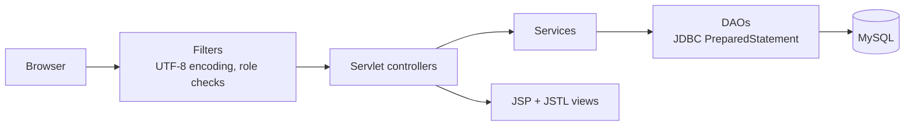
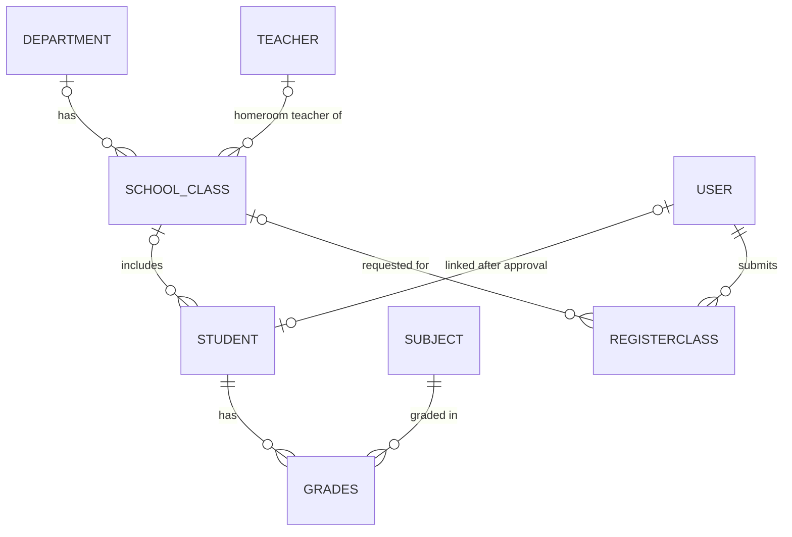

# 🎓 Student Manager

A web application for managing a school's students, teachers, classes, departments, subjects and grades. Admins manage the data, and registered users get a student portal where they can browse classes, check scores and apply to join a class.

Built with **Java Servlet, JSP and MySQL**, following the MVC pattern with separate controller, service and DAO layers.


<!--
## Screenshots
Add 2–3 screenshots to docs/screenshots/ and remove this comment, for example:


-->

## Roles

| Role | How it is created | What it can do |
| --- | --- | --- |
| `master` | Set directly in the database | Everything an admin can do, plus create admin accounts and approve class registrations |
| `admin` | Created by the master | Manage students, teachers, classes, departments, subjects, grades and user accounts |
| `viewer` | Self-registration on the sign-up page | Use the student portal |

## Features

### Admin area (`/admin`)
- Manage **students** (create, edit, delete, search by name)
- Manage **teachers**, **departments** and **subjects**
- Manage **classes** and assign each class a department and a homeroom teacher
- Enter and update **grades**, viewed per student or per subject
- Manage **user accounts**: an admin manages regular users, and the master also manages admins
- **Approve class registrations** (master)
- Change password

### Student portal (`/client`)
- Browse departments, the classes of each department, and their teachers and students
- View students' subject scores
- **Apply to join a class** with a registration form
- Change password

### Accounts
- Register, log in, log out
- Reset a forgotten password with the username and email

### Class registration flow
1. A user signs up and submits the class registration form.
2. The master reviews the requests on the **Browse** page.
3. Approving a request creates the student record, adds a grade entry for every subject, links the new student to the user's account and removes the request. Rejecting it simply removes the request.

## Architecture



- **Filters**: `EncodingFilter` sets UTF-8 for every request, `AdminFilter` only lets `admin` and `master` into `/admin/*`, and `UserFilter` only lets `viewer` accounts into the student portal under `/client/*`
- **Controllers**: one servlet per page, mapped with `@WebServlet`
- **Services**: business logic, such as the class registration approval
- **DAOs**: every query uses `PreparedStatement` with parameters, which prevents SQL injection
- **Views**: JSP pages with JSTL and Bootstrap 5

```
src/main/java/
├── controller/
│   ├── admin/      # students, teachers, classes, departments, subjects, grades, users, registrations
│   ├── client/     # student portal pages
│   ├── auth/       # login, register, forgot password, logout
│   └── filter/     # EncodingFilter, AdminFilter, UserFilter
├── service/        # business logic
└── model/
    ├── dao/        # SQL queries
    ├── dto/        # data joined across tables for the views
    ├── entity/     # one class per table
    └── ConnectDB.java
src/main/webapp/    # JSP views (admin/, client/), CSS, images
StudentManagement.sql
```

## Database



`SCHOOL_CLASS` is the `class` table. `StudentManagement.sql` creates the `studentmanagement` database and its 8 tables. The tables start empty.

## Getting started

### Prerequisites
- JDK 17+
- Maven 3.6+
- Apache Tomcat 9 (the project uses `javax.servlet`, so it does not run on Tomcat 10 or later)
- MySQL 8

### 1. Create the database

```bash
git clone https://github.com/NguyenDacTheDuc/Student-Manager-by-Java-Servlet.git
cd Student-Manager-by-Java-Servlet
mysql -u root -p < StudentManagement.sql
```

### 2. Set the database connection

Edit the connection settings in `src/main/java/model/ConnectDB.java`:

```java
private static String url = "jdbc:mysql://localhost:3306/studentmanagement?useUnicode=true&characterEncoding=UTF-8&serverTimezone=UTC";
private static String user = "root";
private static String pass = "";
```

### 3. Build and deploy

```bash
mvn clean package
```

This creates `target/studentmanagement.war`. The pages use absolute links (for example `/admin/student`), so the app must run at the **root path** `/`:

- **Tomcat**: remove or rename the default `webapps/ROOT` folder, copy the WAR to `webapps/ROOT.war`, then start Tomcat
- **IDE** (IntelliJ IDEA, Eclipse, NetBeans): set the application context to `/`

Then open http://localhost:8080/login.

### 4. Create the first admin account

1. Sign up at http://localhost:8080/register. New accounts get the `viewer` role.
2. Promote that account in MySQL:

   ```sql
   UPDATE studentmanagement.user SET role = 'master' WHERE username = 'your_username';
   ```

3. Log in again to open the admin area, then add departments, teachers, classes and subjects.

## Author

[NguyenDacTheDuc](https://github.com/NguyenDacTheDuc)
